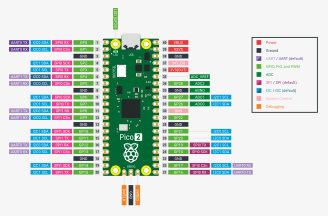
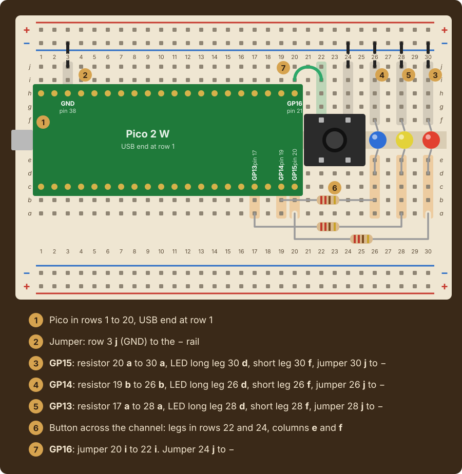
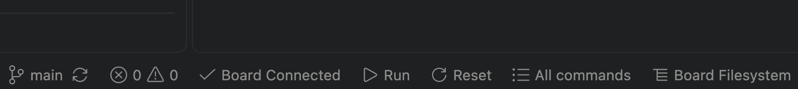

# Lab 7: Stoplight

|Item |       |
|:----|:------|
|Released |Friday, November 6, at the lab session |
|Due |Friday, November 13, 2:30pm |
|Progress |[](../../actions/workflows/main.yml) |

A stoplight is three lights and a few rules about when each one is on. At night, or when an
intersection is under repair, the same lights switch to flashing red or flashing yellow.

In this lab your team builds a stoplight from objects. A `Light` drives one LED, a `Button`
counts presses, and a `Stoplight` runs the three lights in one of three modes and moves to the
next mode when the button is pressed. `main.py` brings them together. Each of you writes one
file, on your own branch, and merges it through a pull request a teammate approves.

## Contents

* [Course learning outcomes](#course-learning-outcomes)
* [Your team](#your-team)
* [The circuit](#the-circuit)
* [The classes](#the-classes)
  * [Light, in light.py](#light-in-lightpy)
  * [Button, in button.py](#button-in-buttonpy)
  * [Stoplight, in stoplight.py](#stoplight-in-stoplightpy)
  * [The program, in main.py](#the-program-in-mainpy)
  * [Expected output](#expected-output)
* [Working as a team](#working-as-a-team)
* [Getting started](#getting-started)
  * [Testing on your Pico](#testing-on-your-pico)
* [Evaluation](#evaluation)
* [Code review](#code-review)
* [Submitting](#submitting)

## Course learning outcomes

This lab addresses the following course learning outcomes:

**CLO 1.** Apply Python programming fundamentals to execute and explain computer code that
implements interactive, novel solutions to a variety of computable problems.

**CLO 2.** Implement code consistent with industry-standard practices using professional-grade
integrated development environments (IDEs), command-line tools, and version control systems.

**CLO 5.** Design, describe, and implement original projects incorporating industry-standard
practices and Python language fundamentals.

Specifically, by the end of this lab you should be able to:

* write a class with `__init__`, attributes that keep their values between calls, and methods
* call a method of the same object with `self`, and keep objects in a dictionary
* import a class from another file
* work on a branch, open a pull request, review a teammate's, and merge it

## Your team

Your team of three or four shares this one repository. The work is four files, one person each:

|File |What it holds |
|:----|:-------------|
|`src/light.py` |the `Light` class |
|`src/button.py` |the `Button` class |
|`src/stoplight.py` |the `Stoplight` class |
|`src/main.py` |the program that makes the objects and runs the stoplight |

A team of three has one extra file: figure out together who takes it, on a branch of its own
with its own pull request. Agree who takes which file before anyone writes code.

## The circuit

Every teammate wires their own board. You need your Lab 5 circuit: three LEDs on GP15, GP14
and GP13, and the push button on GP16. If your board is still wired for Lab 6, put back the
lights on GP14 and GP13 with their resistors and jumpers. If your kit has red, yellow and green
LEDs, put red on GP15, yellow on GP14 and green on GP13. Unplug the USB cable before you touch
the wiring.





If the program reads the button as pressed when nothing touches it, turn the button a quarter
turn. If the button will not work, ask an instructor or TL.

## The classes

Everything this lab asks for is covered by the Week 11 slides and the weeks before them. The
class names, method names and the attributes named below must match exactly, because the
automated checks use them, and because your teammates' code calls yours. Every other name is
your choice. Each method comes with its docstring.

### Light, in light.py

|Method |What it does |
|:------|:------------|
|`__init__(self, pin_number, color)` |Makes an output `Pin` on `pin_number` and stores it, stores `color`, `lit` as `False` and `times_lit` as `0`, and turns the LED off |
|`on(self)` |Turns the LED on, sets `lit` to `True`, and adds 1 to `times_lit` |
|`off(self)` |Turns the LED off and sets `lit` to `False` |

Slides: [Classes and Objects, slides 3 to 5 and 7](https://computationalexpression.com/slides/week-11-session-2/#3),
and [Working as a Team, slide 2](https://computationalexpression.com/slides/week-11-session-3/#2).

### Button, in button.py

|Method |What it does |
|:------|:------------|
|`__init__(self, pin_number)` |Makes an input `Pin` with `Pin.PULL_UP` on `pin_number` and stores it, stores `presses` as `0`, and an attribute that remembers whether the button was down at the last check, `False` to start |
|`check(self)` |Returns `True` when the button is down now and was not down at the last check, and adds 1 to `presses` then. Returns `False` otherwise. Either way, it remembers whether the button is down for the next check |

`PULL_UP` makes a pressed button read `0`. Holding the button down through several checks is
one press. Slides: [Week 8 Session 3](https://computationalexpression.com/slides/week-08-session-3/)
for reading the button.

### Stoplight, in stoplight.py

`Stoplight` is given three `Light` objects and a `Button`. It never makes a `Pin` itself.

An object can be a value in a dictionary, and it can be passed to another object's `__init__` and
stored as an attribute. Either way, you call its methods with a dot. With the `Lamp` from
[Working as a Team, slide 2](https://computationalexpression.com/slides/week-11-session-3/#2):

```python
lamps = {"porch": Lamp(15), "barn": Lamp(14)}
lamps["barn"].flash(0.5)

class Gate:
    def __init__(self, lamp):
        self.lamp = lamp

    def open(self):
        self.lamp.flash(1)

gate = Gate(lamps["porch"])
gate.open()
```

|Method |What it does |
|:------|:------------|
|`__init__(self, red, yellow, green, button)` |Stores the three lights in a dictionary attribute with the keys `"red"`, `"yellow"` and `"green"`, and the button. Stores the list of mode names `["normal", "flashing red", "flashing yellow"]`, `mode` as `0` (the position of the current mode in that list), `requested` as `False`, and `cycles` as `0` |
|`show(self, color)` |Turns on the light of that color and turns every other light off, with a loop over the dictionary |
|`all_off(self)` |Turns every light off |
|`wait(self, seconds)` |Loops over `range(int(seconds * 10))`, one trip/iteration for each tenth of a second. Each one calls `sleep(0.1)`, then the button's `check()`. A press sets `requested` to `True`. The `int` is needed because `0.5 * 10` is the float `5.0`, and `range` takes only an int |
|`mode_name(self)` |Returns the name of the current mode |
|`run_cycle(self)` |Runs one cycle of the current mode, then, when `requested` is `True`, moves `mode` to the next mode and sets `requested` back to `False`. After the last mode comes the first. Adds 1 to `cycles` |

One cycle of each mode, using `self.show`, `self.all_off` and `self.wait`:

|Mode |One cycle |
|:----|:---------|
|normal |red for 3 seconds, then green for 3, then yellow for 1 |
|flashing red |red for half a second, then every light off for half a second |
|flashing yellow |yellow for half a second, then every light off for half a second |

A press never changes the light in the middle of a cycle: the cycle in progress finishes, and
the next cycle runs in the next mode. Slides: [Classes and Objects, slides 7 to 10](https://computationalexpression.com/slides/week-11-session-2/#7),
and [Week 10 Session 2](https://computationalexpression.com/slides/week-10-session-2/) for
looping over a dictionary.

### The program, in main.py

`main` asks which intersection the light is at and how many cycles to run. It makes a `Light`
for each color (red on GP15, yellow on GP14, green on GP13), a `Button` on GP16, and a
`Stoplight` from them. It runs that many cycles, printing the next mode after each one, then
turns every light off. It ends with the stoplight log, and the automated checks read **only the
log**:

```text
STOPLIGHT LOG: Main and Chestnut
==================================================
Cycles: 3
Mode: flashing red
Presses: 1
Red lit: 3
```

`Cycles` is the stoplight's `cycles`, `Mode` is its `mode_name()`, `Presses` is the button's
`presses`, and `Red lit` is the red light's `times_lit`. Print each line any of the three ways
from Week 3; the checks forgive extra spaces and letter case. The program asks the intersection
first and the number of cycles second. Slides: [Working as a Team, slide 3](https://computationalexpression.com/slides/week-11-session-3/#3)
for importing a class from another file.

### Expected output

One run on the board, three cycles, with the button pressed once during the first:

```text
==================================================
STOPLIGHT
==================================================
Which intersection is this light at? Main and Chestnut
How many cycles should it run? 3
Press the button to change the mode when the cycle ends
Cycle 1 done, next mode: flashing red
Cycle 2 done, next mode: flashing red
Cycle 3 done, next mode: flashing red

==================================================
STOPLIGHT LOG: Main and Chestnut
==================================================
Cycles: 3
Mode: flashing red
Presses: 1
Red lit: 3
```

## Working as a team

The slides for each step are [Working as a Team on One Repository](https://computationalexpression.com/slides/week-11-session-3/).

1. **Make your branch**, named for you: `git switch -c your-name`, or click the branch name at
   the bottom left of VS Code and choose **Create new branch**
2. **Write your file, and only your file.** The starter has all four files, so you can begin
   before your teammates finish theirs
3. **Commit and push your branch**: `git add` your file, `git commit`, then
   `git push -u origin your-name`, or **Publish Branch** in Source Control
4. **Open a pull request** on GitHub with **Compare & pull request**
5. **Review in a circle**: in alphabetical order by first name, each person reviews the next
   person's pull request, and the last reviews the first. Open **Files changed**, comment on at
   least one line, then **Review changes**, **Approve**, and **Submit review**
6. **Merge your approved pull request** with **Merge pull request**, not Squash and merge
7. **Update `main`** after each merge with `git switch main` and `git pull`, and start any
   further work on a new branch from there

Each class is checked on its own, so the checks for your file tell you whether your part is
done while the others are still in progress.

## Getting started

Open your file in `src` and work through its `TODO` markers. Check your work as you go, from the
assignment's top-level folder, not from inside `src`:

```text
uv run gatorgrade --config gatorgrade.yml
```

`uv run python src/main.py` runs the program on a laptop once all four files are done, but a
laptop has no button: it reads the button as held down, so the mode changes once, after the
first cycle. Run the program on the Pico to try the button.

### Testing on your Pico

When all four files are merged, pull `main` and run the stoplight on your own board. The Run
button sends only the file you have open, so the three class files have to be on the board
first. Open the folder of this lab in VS Code (File, Open Folder), then right-click each of
`src/light.py`, `src/button.py` and `src/stoplight.py` in the Explorer, choose MicroPico, then
**Upload File to Board**. Upload a file again each time it changes. Then plug in the board,
open `src/main.py`, and click **Run** in the bar along the bottom of the window. **Board
Connected** must show beside it:



## Evaluation

This lab is worth **4.5 points**, the standard value for a lab in this course.

| Component | Points | What it measures |
|:----------|:-------|:-----------------|
| Programming | 3.0 | The 13 code checks below, the same for every teammate. Your score is the fraction passed, times 3.0 |
| Code quality and style | 1.0 | In the file you wrote: descriptive names (0.3), clear organization (0.3), useful comments (0.4) |
| Summary writing | 0.5 | Your answer in `docs/summary.md`, and the team's answer to the last question |
| **Total** | **4.5** | |

Run the checks yourself, as many times as you like, before you submit:

```text
uv run gatorgrade --config gatorgrade.yml
```

Each check's description says what to look at when it fails. Under a failed check, gatorgrade
also prints a `uv run pytest ...` command. Run it: the last lines say what came out and what
was expected. The thirteen code checks:

* `Light` stores its color and state, and `on()` and `off()` drive the LED and update them
* `Button.check()` returns `True` once per new press and counts it
* `show` lights one color and turns the others off, and `all_off` turns them all off
* a normal cycle is red, green, yellow for 3, 3 and 1 seconds
* a flashing cycle is one color for half a second, then dark for half a second
* a press changes the mode when the cycle ends, and the last mode leads back to the first
* `main` runs the cycles and logs them, with every light off at the end
* `Stoplight` keeps its lights in a dictionary and calls its own methods with `self`
* `main.py` imports the three classes and makes the objects
* at least four pull requests are merged with Merge pull request
* the files in `src` have commits from at least two teammates
* no `TODO` markers remain in `src`
* each file in `src` has at least two comments

Partial credit is proportional: passing 10 of 13 checks earns `(10 ÷ 13) × 3.0 = 2.31` points.
The two remaining checks look at `docs/summary.md` and count toward Summary writing.

> [!NOTE]
> Automated results are preliminary. Your instructor sets the final grade.

## Code review

Each teammate has their own code review with a Technical Leader or the instructor, about the
file they wrote and how it works with the others. **Code reviews are graded separately from the
4.5 points above**, under the Code Reviews category on the syllabus.

With you present, you run the stoplight on your board for the reviewer, then answer questions
about your own code. The reviewer opens a **Code Review** issue on your team's repository with
your name on it. The questions differ from student to student. Be ready to:

* **Attributes**: explain what your class keeps track of, and where each attribute gets its
  first value
* **Methods and self**: explain how one of your methods changes an attribute, and what `self`
  is when the method is called
* **Objects working together**: explain how your class is used by, or uses, the other classes
* **Branches and pull requests**: explain your branch and pull request, and what your review
  of a teammate's pull request said

**Your review must be completed during the lab session on the day this lab is due.** If you
know in advance that you cannot attend that lab, make arrangements to complete your review
beforehand at office hours. If your team submitted this lab on time but you missed the code
review, you can make it up at office hours within one week of the due date:

* **Technical Leaders**, listed on the calendar at
  [cis.allegheny.edu/community/news](https://www.cis.allegheny.edu/community/news/)
* **Dr. Jumadinova**, [book a time](https://janyljumadinova.com/office-hours/). Drop-ins are welcome
  during posted hours, but students who booked are seen first

## Submitting

The `main` branch on GitHub at the deadline is what gets graded, so merge every pull request
before then. Open your repository on GitHub and confirm each file and `docs/summary.md` are on
`main`. Write your summary answers on a branch and merge them through a pull request too.

If you need more time, apply a late token with [this form](https://forms.gle/3nGbpaNrG96DpLLdA).
One token covers both parts of a lab: the submission and the code review. A token covers only
the student who applies it, not the team.
